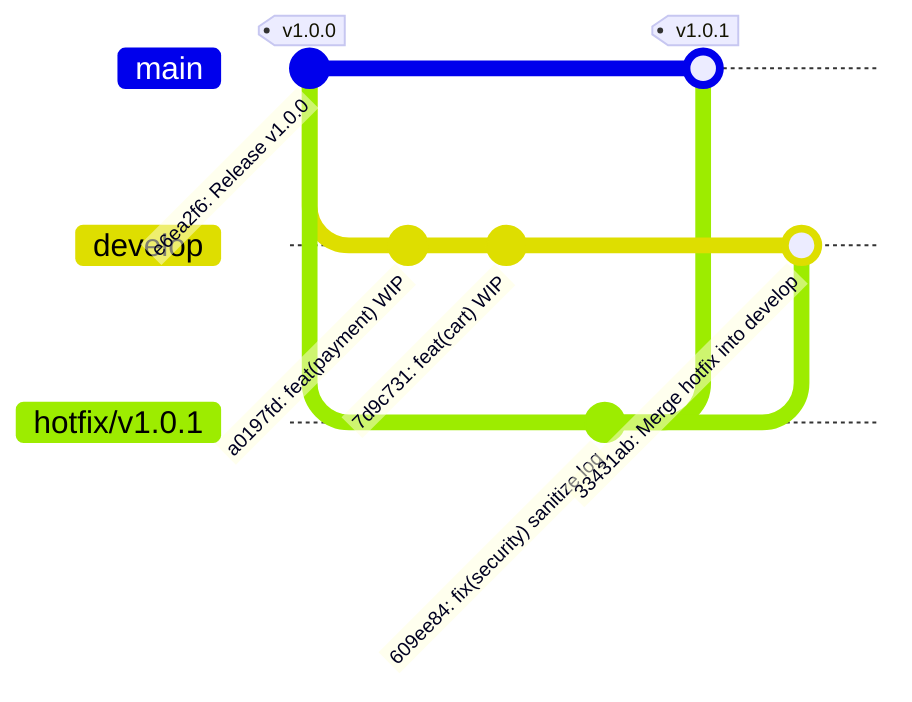

# Báo Cáo Bài Tập 4: Mô Phỏng Quy Trình Hotfix & Gitflow Thực Tế

- **Môn học / Khóa học:** DevOps Engineering
- **Phiên học (Session):** Session 05
- **Bài tập:** Bài 4 - Mô phỏng quy trình Hotfix & Gitflow thực tế
- **Đường dẫn nộp bài dự kiến:** `homework/session_05/ex4/`

---

## 1. Mục Tiêu Bài Học
- **Nắm vững mô hình Gitflow chuẩn:** Hiểu rõ vòng đời của các nhánh dài hạn (`main`, `develop`) và các nhánh hỗ trợ ngắn hạn (`hotfix/*`, `feature/*`, `release/*`).
- **Xử lý sự cố Production an toàn:** Thực hành quy trình tạo bản vá nóng (hotfix) trực tiếp từ mã nguồn đang chạy trên production mà không làm xáo trộn các tính năng đang phát triển.
- **Đồng bộ hóa mã nguồn (Back-merge):** Đảm bảo mã sửa lỗi khẩn cấp được gộp ngược lại vào nhánh phát triển (`develop`), ngăn chặn hiện tượng tái diễn lỗi (regression bug) khi release phiên bản tiếp theo.

---

## 2. Bối Cảnh Sự Cố & Phân Tích Kỹ Thuật

### 2.1. Tình huống thực tế
- **Hệ thống Production:** Đang chạy ổn định tại tag `v1.0.0` trên nhánh `main`. Đột nhiên phát hiện lỗ hổng bảo mật nghiêm trọng: hàm xử lý đăng nhập in thẳng mật khẩu chưa mã hóa của người dùng ra log file (`console.log`).
- **Nhánh Develop:** Đội ngũ phát triển đang viết dở tính năng thanh toán (`payment.js`) và giỏ hàng mới (`cart.js`) cho phiên bản tương lai `v1.1.0`. Mã nguồn này chưa hoàn thiện và chưa qua kiểm thử chất lượng (QA/QC), do đó **tuyệt đối không thể triển khai (deploy) lên production lúc này**.

### 2.2. Chiến lược xử lý chuẩn theo Gitflow
```
[main] v1.0.0 ──────────────────────────────────────────► v1.0.1 (Release Hotfix)
       \                                               ▲
        \──► [hotfix/v1.0.1] (Fix security bug) ───────┤
                                                       \
[develop] ────► feat(payment) ────► feat(cart) ─────────┴► Merge Hotfix (Back-merge)
```
1. **Tách nhánh:** Tạo nhánh `hotfix/v1.0.1` trực tiếp từ nhánh `main` (tại điểm commit của `v1.0.0`).
2. **Sửa lỗi:** Thực hiện vá lỗi bảo mật trên nhánh hotfix và kiểm thử.
3. **Phát hành (Release):** Gộp `hotfix/v1.0.1` vào `main`, gắn tag phiên bản phát hành mới `v1.0.1` để CI/CD triển khai ngay lên Production.
4. **Đồng bộ (Back-merge):** Gộp ngược nhánh `hotfix/v1.0.1` vào nhánh `develop` để toàn bộ nhóm phát triển nhận được bản vá.
5. **Dọn dẹp:** Xóa nhánh `hotfix/v1.0.1` cục bộ sau khi hoàn tất.

---

## 3. Sơ Đồ Phân Nhánh & Đồ Thị Commit

### 3.1. Sơ đồ Gitflow trực quan (Mermaid Diagram)



### 3.2. Sơ đồ ASCII xuất từ `git log --graph --oneline --all --decorate` thực tế

```text
*   33431ab (HEAD -> develop) Merge branch 'hotfix/v1.0.1' into develop
|\  
| * 609ee84 (tag: v1.0.1, main) fix(security): ngan chan ro ri mat khau nguoi dung trong log dang nhap
* | 7d9c731 feat(cart): phat trien giao dien gio hang moi (WIP)
* | a0197fd feat(payment): khoi tao module thanh toan online (WIP)
|/  
* e6ea2f6 (tag: v1.0.0) Release v1.0.0: Initial stable release
```

**Phân tích đồ thị:**
- Commit `e6ea2f6` gắn tag `v1.0.0` là điểm mốc ban đầu trên `main`.
- Nhánh `develop` phát triển độc lập với 2 commit tính năng dở dang `a0197fd` và `7d9c731`.
- Nhánh `main` tiến lên commit `609ee84` chứa bản vá bảo mật và được gắn tag `v1.0.1`.
- Nhánh `develop` hội tụ bản vá `609ee84` thông qua merge commit `33431ab`, giúp nhánh phát triển sở hữu cả các tính năng mới lẫn bản vá bảo mật mà không gây xung đột.

---

## 4. Các Bước Thực Hiện Chi Tiết Từng Lệnh

### Bước 1: Khởi tạo repository và phiên bản Production v1.0.0 trên nhánh `main`

1. Khởi tạo repository với nhánh chính là `main`:
   ```bash
   git init -b main
   ```

2. Tạo file mã nguồn `server.js` có lỗi lộ mật khẩu người dùng:
   ```javascript
   const express = require('express');
   const app = express();

   app.post('/api/login', (req, res) => {
       const { username, password } = req.body;
       // LOI NGIEM TRONG: In truc tiep mat khau nguoi dung vao log
       console.log(`[AUTH] User: ${username} - Password: ${password}`);
       res.json({ status: 'ok', user: username });
   });

   app.listen(3000, () => console.log('App running v1.0.0'));
   ```

3. Commit và gắn tag `v1.0.0`:
   ```bash
   git add server.js
   git commit -m "Release v1.0.0: Initial stable release"
   git tag -a v1.0.0 -m "Release version 1.0.0"
   ```
   *Kết quả terminal:*
   ```text
   [main (root-commit) e6ea2f6] Release v1.0.0: Initial stable release
    1 file changed, 11 insertions(+)
    create mode 100644 server.js
   ```

---

### Bước 2: Tạo nhánh `develop` và phát triển tính năng mới dở dang

1. Tách nhánh `develop` từ `main`:
   ```bash
   git checkout -b develop
   ```

2. Viết tính năng thanh toán dở dang (`payment.js`) và commit:
   ```bash
   git add payment.js
   git commit -m "feat(payment): khoi tao module thanh toan online (WIP)"
   ```
   *Kết quả terminal:* `[develop a0197fd] feat(payment): khoi tao module thanh toan online (WIP)`

3. Viết tính năng giỏ hàng dở dang (`cart.js`) và commit:
   ```bash
   git add cart.js
   git commit -m "feat(cart): phat trien giao dien gio hang moi (WIP)"
   ```
   *Kết quả terminal:* `[develop 7d9c731] feat(cart): phat trien giao dien gio hang moi (WIP)`

---

### Bước 3: Phát hiện sự cố bảo mật - Tạo nhánh `hotfix/v1.0.1` từ `main`

Khi phát hiện sự cố trên production, chuyển về `main` và tách nhánh sửa lỗi khẩn cấp:
```bash
git checkout main
git checkout -b hotfix/v1.0.1
```
*Kết quả terminal:*
```text
Switched to branch 'main'
Switched to a new branch 'hotfix/v1.0.1'
```

---

### Bước 4: Vá lỗi bảo mật trên nhánh `hotfix/v1.0.1`

1. Sửa `server.js` để loại bỏ log chứa thông tin nhạy cảm:
   ```javascript
   const express = require('express');
   const app = express();

   app.post('/api/login', (req, res) => {
       const { username, password } = req.body;
       // HOTFIX: Da loai bo in mat khau nguoi dung, chi log username an toan
       console.log(`[AUTH] User login attempt: ${username} - Status: sanitized`);
       res.json({ status: 'ok', user: username });
   });

   app.listen(3000, () => console.log('App running v1.0.1'));
   ```

2. Lưu và commit thay đổi:
   ```bash
   git add server.js
   git commit -m "fix(security): ngan chan ro ri mat khau nguoi dung trong log dang nhap"
   ```
   *Kết quả terminal:*
   ```text
   [hotfix/v1.0.1 609ee84] fix(security): ngan chan ro ri mat khau nguoi dung trong log dang nhap
    1 file changed, 3 insertions(+), 3 deletions(-)
   ```

---

### Bước 5: Gộp `hotfix/v1.0.1` vào `main` và gắn tag phát hành `v1.0.1`

Chuyển về `main`, gộp nhánh hotfix và đánh dấu phiên bản:
```bash
git checkout main
git merge hotfix/v1.0.1
git tag -a v1.0.1 -m "Release Hotfix 1.0.1"
```
*Kết quả terminal:*
```text
Switched to branch 'main'
Updating e6ea2f6..609ee84
Fast-forward
 server.js | 6 +++---
 1 file changed, 3 insertions(+), 3 deletions(-)
```

---

### Bước 6: Gộp ngược `hotfix/v1.0.1` vào nhánh `develop` (Back-merge)

Chuyển về nhánh `develop` và gộp nhánh hotfix:
```bash
git checkout develop
git merge hotfix/v1.0.1 -m "Merge branch 'hotfix/v1.0.1' into develop"
```
*Kết quả terminal:*
```text
Switched to branch 'develop'
Merge made by the 'ort' strategy.
 server.js | 6 +++---
 1 file changed, 3 insertions(+), 3 deletions(-)
```
*(Git tự động áp dụng chiến lược gộp 3-way merge và tạo ra commit merge `33431ab`)*

---

### Bước 7: Dọn dẹp nhánh Hotfix cục bộ

Sau khi đã hoàn tất gộp vào cả 2 nhánh chính, xóa nhánh hotfix:
```bash
git branch -d hotfix/v1.0.1
```
*Kết quả terminal:*
```text
Deleted branch hotfix/v1.0.1 (was 609ee84).
```

---

## 5. Kiểm Tra và Xác Thực Kết Quả

### 5.1. Kiểm tra danh sách các nhánh
```bash
git branch -a
```
*Đầu ra thực tế:*
```text
* develop
  main
```
*(Nhánh hotfix tạm thời đã được dọn dẹp sạch sẽ, chỉ còn 2 nhánh dài hạn)*

### 5.2. Kiểm tra danh sách tag phiên bản
```bash
git tag
```
*Đầu ra thực tế:*
```text
v1.0.0
v1.0.1
```

### 5.3. Kiểm tra sơ đồ lịch sử gộp nhánh
```bash
git log --graph --oneline --all --decorate
```
*Đầu ra thực tế:*
```text
*   33431ab (HEAD -> develop) Merge branch 'hotfix/v1.0.1' into develop
|\  
| * 609ee84 (tag: v1.0.1, main) fix(security): ngan chan ro ri mat khau nguoi dung trong log dang nhap
* | 7d9c731 feat(cart): phat trien giao dien gio hang moi (WIP)
* | a0197fd feat(payment): khoi tao module thanh toan online (WIP)
|/  
* e6ea2f6 (tag: v1.0.0) Release v1.0.0: Initial stable release
```

### 5.4. Xác thực trạng thái mã nguồn trên 2 nhánh

| Nhánh | Các file hiện diện | Trạng thái bảo mật của `server.js` |
| :--- | :--- | :--- |
| **`main`** | `server.js` | Đã vá lỗi (không chứa code WIP `payment.js`, `cart.js`) |
| **`develop`** | `server.js`, `payment.js`, `cart.js` | Đã vá lỗi và vẫn giữ nguyên code tính năng đang phát triển |

---

## 6. Phân Tích Chuyên Sâu & Best Practices

### 6.1. Tại sao bắt buộc phải Back-merge vào `develop`?
Nếu quên bước gộp ngược lại vào `develop`:
- Nhánh `main` có bản vá `v1.0.1`.
- Tuy nhiên nhánh `develop` vẫn giữ file `server.js` cũ (chứa lỗ hổng lộ mật khẩu).
- Sau này, khi nhánh `develop` hoàn thành phiên bản `v1.1.0` và release lên `main`, code cũ từ `develop` sẽ ghi đè và **làm sống lại lỗi bảo mật đã từng sửa**. Đây được gọi là lỗi hồi quy (**Regression Bug**).

### 6.2. Lựa chọn `--no-ff` (No Fast-Forward) trong Gitflow
Trong mô hình Gitflow nguyên bản của Vincent Driessen, khuyến nghị sử dụng cờ `--no-ff` (`git merge --no-ff hotfix/...`) ngay cả khi có thể fast-forward vào `main`. Điều này giúp:
- Luôn tạo ra một merge commit đại diện cho toàn bộ đợt hotfix.
- Dễ dàng revert lại toàn bộ đợt sửa lỗi chỉ với 1 thao tác revert merge commit nếu bản vá phát sinh lỗi phụ ngoài dự kiến.
